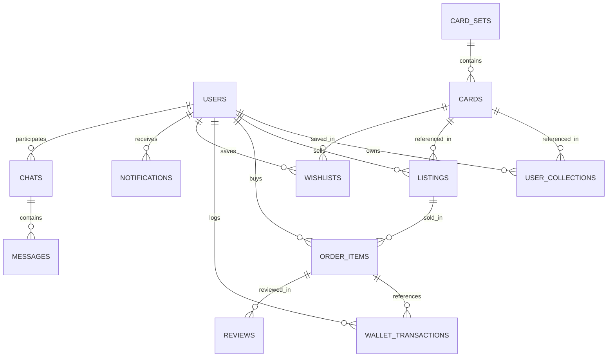
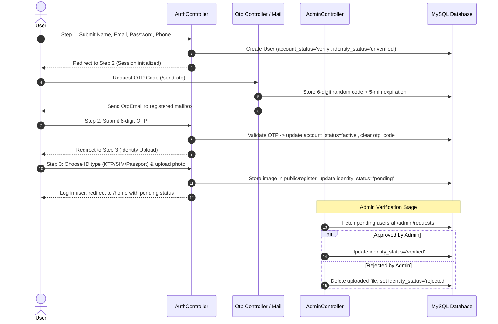

# PocketRader - Pokemon Card Trading & Marketplace Platform
## Comprehensive Technical & Project Documentation

**Course:** BackEnd Web Programming (BWP) - Semester 3  
**Repository:** `fertan15/BackEndWebProgramming-Project`  
**Framework:** Laravel 12 (PHP 8.2+)  
**Database:** MySQL / MariaDB (`pocketraderdb`)  
**Payment Gateway:** Midtrans Snap Payment Gateway  

---

## Table of Contents
1. [Project Overview](#1-project-overview)
2. [System Architecture](#2-system-architecture)
3. [Technology Stack](#3-technology-stack)
4. [Database Design & Schema (ERD)](#4-database-design--schema-erd)
5. [Key Feature Modules & Workflows](#5-key-feature-modules--workflows)
   - [5.1 Authentication & Multi-Step KYC Registration](#51-authentication--multi-step-kyc-registration)
   - [5.2 Card Catalog & Set Management](#52-card-catalog--set-management)
   - [5.3 Steam-Style Marketplace & P2P Trading](#53-steam-style-marketplace--p2p-trading)
   - [5.4 Inventory & Card Lock/Unlock System](#54-inventory--card-lockunlock-system)
   - [5.5 Midtrans Top-Up & Wallet Architecture](#55-midtrans-top-up--wallet-architecture)
   - [5.6 In-App Real-Time Messaging / Chat](#56-in-app-real-time-messaging--chat)
   - [5.7 Notification & Wishlist Systems](#57-notification--wishlist-systems)
   - [5.8 Admin Management Portal](#58-admin-management-portal)
   - [5.9 Market Analytics & Performance Dashboard](#59-market-analytics--performance-dashboard)
6. [API & Route Specifications](#6-api--route-specifications)
7. [Security & Middleware Configuration](#7-security--middleware-configuration)
8. [Installation & Setup Guide](#8-installation--setup-guide)
9. [Directory Structure](#9-directory-structure)

---

## 1. Project Overview

**PocketRader** is a web-based Pokemon Trading Card Game (TCG) marketplace and collector platform. Inspired by digital marketplaces like the Steam Community Market and TCGPlayer, PocketRader enables collectors to browse comprehensive card expansions, track market valuations, manage their card binders/inventory, trade directly with other verified collectors, and execute secure real-time digital transactions.

### Key Objectives
- **Secure P2P Trading:** Enforce identity verification (Know Your Customer / KYC) and OTP verification to minimize fraudulent listings.
- **Dynamic Marketplace:** Facilitate multi-condition card listings (Mint, Near Mint, Lightly Played, Heavily Played, Damaged) with automated ownership transfers.
- **Steam Market-like Pricing:** Display historical price trends, active seller listings, and recent platform sales.
- **Financial Integrity:** Integrated wallet with double-entry transaction ledger (`wallet_transactions`) and Midtrans Snap payment gateway.
- **Direct Buyer-Seller Communication:** Integrated peer-to-peer chat system for negotiating and coordinating trades.

---

## 2. System Architecture

PocketRader follows the classic **Model-View-Controller (MVC)** architectural pattern implemented via Laravel 12.

```
       +-------------------------------------------------------------+
       |                         Client Layer                        |
       |  (Blade Views, jQuery, Bootstrap / LineIcons, Chart.js)     |
       +------------------------------+------------------------------+
                                      | HTTP Requests / AJAX
                                      v
       +-------------------------------------------------------------+
       |                     Routing & Middleware                    |
       |  - routes/web.php                                           |
       |  - auth, verified, verified.transaction, CSRF protection     |
       +------------------------------+------------------------------+
                                      |
                                      v
       +-------------------------------------------------------------+
       |                      Controller Layer                       |
       |  AuthController, CardController, CheckoutController,        |
       |  HomeController, TopUpController, chatController,           |
       |  NotificationController, AdminController, DashboardController|
       +------------------------------+------------------------------+
                                      |
                 +--------------------+--------------------+
                 |                                         |
                 v                                         v
+-----------------------------------+   +------------------------------------+
|           Domain Models           |   |       External Services & Mail     |
| Users, Cards, CardSets, Listings, |   | - Midtrans Snap Payment Gateway    |
| OrderItems, UserCollections,      |   | - Laravel Mailable (OtpEmail)      |
| WalletTransactions, Chats, etc.   |   | - File Storage (public/register,   |
+-----------------+-----------------+   |   public/images/cards)             |
                  |                     +------------------------------------+
                  v
+-----------------------------------+
|      Database Layer (MySQL)       |
|          `pocketraderdb`          |
+-----------------------------------+
```

---

## 3. Technology Stack

| Layer | Technology | Details |
|---|---|---|
| **Back-End Framework** | Laravel 12.x | PHP 8.2+, Eloquent ORM, Database Transactions |
| **Database** | MySQL / MariaDB | Relational schema with Foreign Key cascading & indexing |
| **Front-End** | Blade Templating | Responsive UI, LineIcons (`lni`), Bootstrap grid, jQuery |
| **Payment Gateway** | Midtrans PHP SDK / REST API | Snap Token sandbox, Webhook verification with SHA-512 |
| **Mail Services** | Laravel Mailable / SMTP | `OtpEmail` sending for 6-digit verification codes |
| **Data Visualization**| Chart.js / ApexCharts | Price fluctuation curves and trend lines |
| **Build & Tooling** | Vite / Concurrently | Asset bundling, local development server |

---

## 4. Database Design & Schema (ERD)

The relational schema is configured in `pocketraderdb.sql`. Below is the entity relationship overview:



### Table Details & Schema Specifications

#### 1. `users`
Stores user profile, authentication credentials, balance, and KYC verification statuses.
- `id` (INT PK, AUTO_INCREMENT)
- `name` (VARCHAR 100): Full legal name.
- `username` (VARCHAR 50, UNIQUE): Unique display username.
- `password_hash` (VARCHAR 255): Bcrypt hashed password.
- `email` (VARCHAR 100, UNIQUE): User contact email.
- `phone_number` (VARCHAR 20, NULL): Contact phone number.
- `balance` (DECIMAL 10,2, DEFAULT 0.00): Internal store credit balance.
- `identity_type` (ENUM: 'KTP', 'SIM', 'Passport', NULL): KYC document category.
- `identity_number` (VARCHAR 50, UNIQUE, NULL): Official government ID number.
- `identity_image_url` / `identity_card_url` (VARCHAR 255, NULL): Uploaded KYC file path.
- `identity_status` (ENUM: 'unverified', 'pending', 'verified', 'rejected', DEFAULT 'unverified').
- `otp_code` (VARCHAR 10, NULL): 6-digit registration OTP code.
- `otp_expires_at` (TIMESTAMP, NULL): OTP expiry deadline (5 mins).
- `account_status` (ENUM: 'active', 'suspended', 'banned', 'verify', DEFAULT 'verify').
- `ban_reason` (VARCHAR 255, NULL), `banned_at` (TIMESTAMP, NULL).
- `is_admin` (TINYINT 1, DEFAULT 0): Role flag.
- `last_online` (TIMESTAMP), `created_at` (TIMESTAMP).

#### 2. `card_sets`
Represents official Pokemon card expansion sets.
- `id` (INT PK, AUTO_INCREMENT)
- `name` (VARCHAR 100): e.g., 'Genetic Apex', 'Mythical Island', 'Mega Rising'.
- `release_date` (DATE)
- `description` (TEXT)
- `image_url` (VARCHAR 255): Set promotional banner/pack image.
- `total_cards` (INT, DEFAULT 0): Automatically synced with card counts.

#### 3. `cards`
Catalog of distinct cards belonging to expansions.
- `id` (INT PK, AUTO_INCREMENT)
- `card_set_id` (INT FK -> `card_sets.id` ON DELETE CASCADE)
- `name` (VARCHAR 100): e.g., 'Charizard EX', 'Pikachu EX', 'Bulbasaur'.
- `card_type` (VARCHAR 50): 'Grass', 'Fire', 'Water', 'Lightning', 'Psychic', 'Dragon', etc.
- `image_url` (VARCHAR 255): Official card artwork image.
- `rarity` (VARCHAR 50): '1-Diamond', '4-Diamond', '1-Star', '3-Star', 'Crown', etc.
- `edition` (VARCHAR 50): 'Normal', 'EX', 'Mega EX', 'Illustration Rare', 'Crown Rare', etc.
- `estimated_market_price` (DECIMAL 10,2, DEFAULT 0.00): Base market benchmark.

#### 4. `user_collections`
Personal binders of cards owned by collectors.
- `id` (INT PK, AUTO_INCREMENT)
- `user_id` (INT FK -> `users.id` ON DELETE CASCADE)
- `card_id` (INT FK -> `cards.id`)
- `condition_text` (ENUM: 'Mint', 'Near Mint', 'Lightly Played', 'Heavily Played', 'Damaged')
- `is_for_trade` (TINYINT 1, DEFAULT 0): When `false`, locked to prevent accidental listing.
- `is_listed` (TINYINT 1, DEFAULT 0): Flagged when currently in an active marketplace listing.
- `added_at` (TIMESTAMP)

#### 5. `listings`
Active marketplace offers posted by users.
- `id` (INT PK, AUTO_INCREMENT)
- `card_id` (INT FK -> `cards.id`)
- `seller_id` (INT FK -> `users.id` ON DELETE CASCADE)
- `user_collection_id` (INT FK -> `user_collections.id`, NULL)
- `price` (DECIMAL 10,2): Listing asking price.
- `condition_text` (ENUM: 'Mint', 'Near Mint', 'Lightly Played', 'Heavily Played', 'Damaged')
- `description` (TEXT, NULL)
- `quantity` (INT, DEFAULT 1)
- `is_active` (TINYINT 1, DEFAULT 1): Set to 0 once sold out or cancelled.
- `created_at` (TIMESTAMP)

#### 6. `order_items`
Records completed card purchase transactions.
- `id` (INT PK, AUTO_INCREMENT)
- `listing_id` (INT FK -> `listings.id`)
- `buyer_id` (INT FK -> `users.id`)
- `quantity` (INT, DEFAULT 1)
- `price_at_purchase` (DECIMAL 10,2)
- `purchased_at` (DATETIME)

#### 7. `wallet_transactions`
Ledger of financial movements (top-ups, purchases, sales revenues, refunds).
- `id` (INT PK, AUTO_INCREMENT)
- `user_id` (INT FK -> `users.id` ON DELETE CASCADE)
- `reference_order_item_id` (INT FK -> `order_items.id`, NULL)
- `amount` (DECIMAL 10,2): Positive for credit, negative for debit.
- `transaction_type` (ENUM: 'TOPUP', 'PURCHASE', 'SALES_REVENUE', 'WITHDRAWAL', 'REFUND')
- `description` (VARCHAR 255)
- `created_at` (TIMESTAMP)

#### 8. `chats` & `messages`
Peer-to-peer user direct communication.
- `chats`: `id` (PK), `user1_id` (FK), `user2_id` (FK), `created_at`
- `messages`: `id` (PK), `chat_id` (FK -> `chats.id` ON DELETE CASCADE), `sender_id` (FK -> `users.id`), `content` (TEXT), `sent_at` (TIMESTAMP), `read` (TINYINT 1)

#### 9. `notifications`
In-app notification system.
- `id` (BIGINT PK)
- `user_id` (BIGINT FK, NULL for broadcast/fan-out)
- `type` (VARCHAR 255): 'PURCHASE', 'SALES', 'order', 'message', 'listing', 'system', 'wishlist'
- `title` (VARCHAR 255), `message` (TEXT), `action_url` (VARCHAR 255, NULL)
- `is_read` (TINYINT 1), `read_at` (TIMESTAMP, NULL)
- `created_at` (TIMESTAMP), `updated_at` (TIMESTAMP)

#### 10. `wishlists` & `reviews`
- `wishlists`: `id` (PK), `user_id` (FK), `card_id` (FK), `added_at` (UNIQUE constraint on `(user_id, card_id)`)
- `reviews`: `id` (PK), `reviewer_id` (FK), `reviewee_id` (FK), `order_item_id` (FK), `rating` (1-5), `comment` (TEXT), `created_at`

---

## 5. Key Feature Modules & Workflows

### 5.1 Authentication & Multi-Step KYC Registration



### 5.2 Card Catalog & Set Management
- **Card Sets Showcase (`/card_sets`):** Lists all release expansions with dynamic counts of total cards using Eloquent `withCount('cards')`.
- **Set Browsing (`/sets/{setId}/cards`):** Displays all cards belonging to a given set with user wishlist state.
- **Card Detail View (`/cards/{cardId}`):**
  - High-resolution card artwork and card properties (type, rarity, edition).
  - Dynamic 30-day price trend chart (visualized via Chart.js).
  - Real-time active listings table sorted ascending by price.
  - Recent sales history table showing past buyers, prices, and timestamps.
  - Related cards carousel from the same expansion.

### 5.3 Steam-Style Marketplace & P2P Trading
- **Creating Listings:** Verified sellers can list cards directly from their inventory (`/inventory/add-listing/{collectionId}`) or card detail page.
- **Unified Checkout Experience:** 
  - Accessed via `/checkout/listing/{listingId}` or direct buy `/checkout?card_id={cardId}`.
  - Guarded by the `verified.transaction` middleware.
- **Atomic Purchase Execution (`DB::transaction`):**
  1. Checks buyer's balance against listing price * quantity.
  2. Debits buyer's balance (`users.balance`).
  3. Credits seller's balance (`users.balance`).
  4. Ownership Transfer: If linked to `user_collection_id`, reassigns `user_id` to the buyer; otherwise, creates new `user_collections` records.
  5. Inserts audit records in `order_items`.
  6. Creates two corresponding entries in `wallet_transactions`:
     - Debit for Buyer (`transaction_type: 'PURCHASE'`, negative amount).
     - Credit for Seller (`transaction_type: 'SALES_REVENUE'`, positive amount).
  7. Reduces listing quantity; if 0, marks `is_active = 0`.
  8. Dispatches instant in-app `Notification` to both buyer and seller.

### 5.4 Inventory & Card Lock/Unlock System
- **Collection Management (`/inventory`):**
  - **Tradeable Cards:** Cards where `is_for_trade = 1`. Users can list them directly on the marketplace.
  - **Locked Cards:** Cards where `is_for_trade = 0`. Protects high-value or sentimental cards from accidental listing.
- **Instant Actions:** Dedicated POST routes `/inventory/lock/{collectionId}` and `/inventory/unlock/{collectionId}`.

### 5.5 Midtrans Top-Up & Wallet Architecture
- Users select an IDR top-up tier on `/topup`.
- `TopUpController@getSnapToken` connects to the Midtrans Sandbox API (`https://app.sandbox.midtrans.com/snap/v1/transactions`) using `MIDTRANS_SERVER_KEY` and returns a Snap Token.
- Client opens the Midtrans Snap payment popup (GoPay, Virtual Accounts, Credit Card, QRIS).
- **Webhook Callback (`/topup/notification`):**
  - Verified with SHA-512 signature: `hash("sha512", order_id + status_code + gross_amount + serverKey)`.
  - On `capture` or `settlement`, calculates USD equivalent (`idrAmount / 15800`), adds credit to user's wallet, and logs a `wallet_transactions` record of type `TOPUP`.

### 5.6 In-App Real-Time Messaging / Chat
- Dedicated conversation view (`/chat`) between buyers and sellers.
- Supports starting chats directly with users (`/chat/start`), fetching message history (`/chat/{chat}/messages`), and sending messages via AJAX (`/chat/{chat}/message`).
- Automatically updates unread status when messages are opened.

### 5.7 Notification & Wishlist Systems
- **Notifications (`/notifications`):**
  - Categorized types: `PURCHASE`, `SALES`, `order`, `message`, `listing`, `system`, `wishlist`.
  - Unread badge counter polled via AJAX (`/notifications/unread-count`).
  - System-wide broadcast notifications fanned out to all users by admins.
- **Wishlist (`/wishlist`):**
  - One-click heart toggle on card grids (`/wishlist/toggle/{cardId}`) with instant AJAX feedback.

### 5.8 Admin Management Portal (`/admin`)
- Accessible strictly by users with `is_admin = 1` in session.
- **User Governance (`/admin/users`, `/admin/users/{id}`):** View all registered users, inspection of KYC data, ban/unban toggle.
- **KYC Approval Portal (`/admin/requests`):** Review identity cards/passports. One-click approve or reject (which cleans up disk files and alerts the user to resubmit).
- **Expansion Set Creation (`/admin/card-sets/create`):** Upload set artwork and create new expansion sets.
- **Card Creator (`/admin/cards/create`, DELETE `/admin/cards/{id}`):** Add individual Pokemon cards with artwork, rarity, type, and auto-sync set counts.

### 5.9 Market Analytics & Performance Dashboard (`/home`)
- **Global Platform Analytics:**
  - Top Seller (highest sales revenue).
  - Top Buyer (highest spending).
  - Most Traded Card (highest transaction volume).
  - Total Gross Merchandise Value (GMV) and transaction count.
- **Personalized User Analytics:**
  - Sales revenue earned, purchase spending, active listing counts, most sold card.

---

## 6. API & Route Specifications

### Authentication Routes
| Method | URI | Controller Action | Middleware | Description |
|---|---|---|---|---|
| `GET` | `/login` | `AuthController@showLogin` | `web` | Display login form |
| `POST` | `/login` | `AuthController@login` | `web` | Handle login submission |
| `GET` | `/register/step1` | `AuthController@showRegisterStep1` | `web` | Step 1: Basic details form |
| `POST` | `/register/step2` | `AuthController@storeRegisterStep1`| `web` | Save Step 1, proceed to Step 2 |
| `GET` | `/register/step2` | `AuthController@showRegisterStep2` | `web` | Step 2: OTP verification form |
| `POST` | `/register/step3` | `AuthController@storeRegisterStep2`| `web` | Validate OTP, proceed to Step 3 |
| `GET` | `/register/step3` | `AuthController@showRegisterStep3` | `web` | Step 3: Identity verification form |
| `POST` | `/register/complete` | `AuthController@completeRegistration` | `web` | Upload KYC, complete registration |
| `POST` | `/send-otp` | `Otp@sendOtp` | `web` | Generate and email OTP code |
| `GET`/`POST` | `/logout` | `HomeController@logout` | `web` | Terminate session and logout |

### Marketplace & Card Routes
| Method | URI | Controller Action | Middleware | Description |
|---|---|---|---|---|
| `GET` | `/home` | `HomeController@index` | `web` | Homepage & market analytics |
| `GET` | `/card_sets` | `CardController@showCardSets` | `web` | List all expansion sets |
| `GET` | `/sets/{setId}/cards` | `CardController@showCards` | `web` | View cards in specific set |
| `GET` | `/cards` | `CardController@showAllCards` | `web` | Browse all cards catalog |
| `GET` | `/cards/{cardId}` | `CardController@showCardDetail` | `web` | Card detail, listings & price history |
| `POST` | `/savelistings` | `CardController@savelisting` | `verified.transaction` | Create new listing from card detail |
| `POST` | `/cancel-listing/{id}`| `CardController@cancelListing` | `web` | Cancel active listing |
| `GET` | `/search` | `DashboardController@search` | `web` | Search cards by name |

### Checkout & Order Routes
| Method | URI | Controller Action | Middleware | Description |
|---|---|---|---|---|
| `GET` | `/checkout` | `CheckoutController@showCheckout` | `verified.transaction` | Direct card checkout page |
| `GET` | `/checkout/listing/{id}` | `CheckoutController@showCheckoutListing` | `verified.transaction` | Listing checkout page |
| `POST` | `/purchase/process` | `CheckoutController@processPurchase` | `verified.transaction` | Process direct card purchase |
| `POST` | `/buy-listing/{id}` | `CheckoutController@buyListing` | `verified.transaction` | Purchase from listing (P2P) |
| `GET` | `/orders` | `CheckoutController@history` | `auth` | User order history |
| `GET` | `/orders/{id}/invoice` | `CheckoutController@invoice` | `auth` | View purchase invoice |
| `GET` | `/history` | `HomeController@showHistory` | `auth` | Comprehensive buying & selling history |

### Inventory & Wishlist Routes
| Method | URI | Controller Action | Middleware | Description |
|---|---|---|---|---|
| `GET` | `/inventory` | `HomeController@showInventory` | `web` | User inventory (Tradeable vs Locked) |
| `POST` | `/inventory/add-listing/{id}` | `HomeController@addListing` | `verified.transaction` | Create listing from inventory |
| `POST` | `/inventory/lock/{id}` | `HomeController@lockCard` | `web` | Lock card to prevent trading |
| `POST` | `/inventory/unlock/{id}` | `HomeController@unlockCard` | `web` | Unlock card for trading |
| `GET` | `/wishlist` | `HomeController@showWishlist` | `verified` | View user's wishlist |
| `POST` | `/wishlist/toggle/{id}` | `HomeController@toggleWishlist` | `verified` | Add/remove card from wishlist |

### Wallet & Top-Up Routes
| Method | URI | Controller Action | Middleware | Description |
|---|---|---|---|---|
| `GET` | `/topup` | `TopUpController@show` | `web` | Wallet top-up page |
| `POST` | `/topup/snap` | `TopUpController@getSnapToken` | `web` | Request Midtrans Snap token |
| `POST` | `/topup/notification` | `TopUpController@handleNotification` | *CSRF Exempt* | Midtrans Webhook payment notification |

### Chat & Notification Routes
| Method | URI | Controller Action | Middleware | Description |
|---|---|---|---|---|
| `GET` | `/chat` | `chatController@chat` | `web` | User chat inbox |
| `POST` | `/chat/start` | `chatController@start` | `web` | Initialize chat with user |
| `GET` | `/chat/{id}/messages` | `chatController@messages` | `web` | Fetch chat message thread |
| `POST` | `/chat/{id}/message` | `chatController@sendMessage` | `web` | Send message in chat |
| `GET` | `/notifications` | `NotificationController@index` | `web` | View notifications |
| `POST` | `/notifications/{id}/read` | `NotificationController@markAsRead` | `auth` | Mark single notification as read |
| `POST` | `/notifications/mark-all-read` | `NotificationController@markAllAsRead`| `auth` | Mark all notifications read |
| `DELETE`| `/notifications/{id}` | `NotificationController@destroy` | `auth` | Delete notification |
| `GET` | `/notifications/unread-count` | `NotificationController@unreadCount` | `web` | Polling endpoint for unread count |

### Admin Portal Routes (`/admin/*`)
| Method | URI | Controller Action | Middleware | Description |
|---|---|---|---|---|
| `GET` | `/admin` | `AdminController@index` | `Admin Gate` | Redirects to `/admin/users` |
| `GET` | `/admin/users` | `AdminController@users` | `Admin Gate` | Manage all registered users |
| `GET` | `/admin/users/{id}` | `AdminController@userDetail` | `Admin Gate` | Inspect user KYC profile |
| `PUT` | `/admin/users/{id}/ban` | `AdminController@banUser` | `Admin Gate` | Ban or unban user |
| `GET` | `/admin/requests` | `AdminController@requests` | `Admin Gate` | List pending KYC requests |
| `POST` | `/admin/requests/{id}/approve` | `AdminController@approveRequest` | `Admin Gate` | Approve user identity |
| `POST` | `/admin/requests/{id}/reject` | `AdminController@rejectRequest` | `Admin Gate` | Reject user identity & purge upload |
| `GET` | `/admin/card-sets/create` | `AdminController@createCardSetForm` | `Admin Gate` | Form to create card set |
| `POST` | `/admin/card-sets` | `AdminController@storeCardSet` | `Admin Gate` | Store card set & upload asset |
| `GET` | `/admin/cards/create` | `AdminController@createCardForm` | `Admin Gate` | Form to create individual card |
| `POST` | `/admin/cards` | `AdminController@storeCard` | `Admin Gate` | Store card & upload image |
| `DELETE`| `/admin/cards/{id}` | `AdminController@deleteCard` | `Admin Gate` | Delete card and remove image |

---

## 7. Security & Middleware Configuration

1. **Authentication Gateways (`Authenticate.php` / `auth`):**
   - Validates active user sessions before accessing private pages (invoices, orders, notifications, history).
2. **Transaction Identity Guard (`CheckVerifiedForTransaction.php` / `verified.transaction`):**
   - Strictly enforces that users must have `identity_status === 'verified'` before buying cards, checking out, or listing inventory items for sale.
   - Gracefully handles AJAX vs. web requests with structured JSON error responses.
3. **Admin Privilege Enforcement (`AdminController::__construct`):**
   - Restricts administration functions to session `is_admin == 1`.
4. **CSRF Protection & Webhook Exemption (`bootstrap/app.php`):**
   - Default Laravel CSRF protection active on all web forms.
   - Specifically excludes `topup/notification` so Midtrans server-to-server callbacks can deliver webhook payloads.
5. **Secure Signature Verification for Payments:**
   - Webhooks compute a SHA-512 digest utilizing the secret `MIDTRANS_SERVER_KEY` to guarantee authenticity and prevent unauthorized wallet manipulation.

---

## 8. Installation & Setup Guide

### Prerequisites
- **PHP:** 8.2 or higher (with `pdo_mysql`, `curl`, `openssl`, `mbstring`, `fileinfo` extensions enabled)
- **Composer:** 2.x
- **Node.js & NPM:** Node 18+
- **Database:** MySQL / MariaDB (e.g., via XAMPP, Laragon, or standalone service)

### Step-by-Step Setup

1. **Clone the Repository:**
   ```bash
   git clone https://github.com/fertan15/BackEndWebProgramming-Project.git
   cd BackEndWebProgramming-Project
   ```

2. **Install Dependencies:**
   ```bash
   composer install
   npm install
   ```

3. **Configure Environment File (`.env`):**
   Copy `.env.example` to `.env` or create `.env`:
   ```bash
   cp .env.example .env
   php artisan key:generate
   ```
   Update the database and mail settings in `.env`:
   ```ini
   DB_CONNECTION=mysql
   DB_HOST=127.0.0.1
   DB_PORT=3306
   DB_DATABASE=pocketraderdb
   DB_USERNAME=root
   DB_PASSWORD=

   # Midtrans Sandbox Credentials
   MIDTRANS_SERVER_KEY=your-sandbox-server-key
   MIDTRANS_CLIENT_KEY=your-sandbox-client-key
   MIDTRANS_IS_PRODUCTION=false

   # Mail settings (for OTP verification)
   MAIL_MAILER=smtp
   MAIL_HOST=sandbox.smtp.mailtrap.io
   MAIL_PORT=2525
   MAIL_USERNAME=your-mailtrap-username
   MAIL_PASSWORD=your-mailtrap-password
   MAIL_FROM_ADDRESS="no-reply@pocketrader.com"
   MAIL_FROM_NAME="PocketRader"
   ```

4. **Import Database Schema & Data:**
   Import the included SQL dump into MySQL:
   ```bash
   mysql -u root -p pocketraderdb < pocketraderdb.sql
   ```

5. **Create Storage & Upload Directories:**
   Ensure public upload folders exist and have write permissions:
   ```bash
   mkdir -p public/register public/images/card_set public/images/cards
   ```

6. **Run the Development Server:**
   ```bash
   php artisan serve
   ```
   Or run with Vite concurrently:
   ```bash
   composer run dev
   ```
   Access the application at `http://localhost:8000`.

---

## 9. Directory Structure

```
BackEndWebProgramming-Project/
├── app/
│   ├── Http/
│   │   ├── Controllers/
│   │   │   ├── AdminController.php         # User management, KYC approval, card creation
│   │   │   ├── AuthController.php          # Login, 3-step registration & KYC upload
│   │   │   ├── CardController.php          # Sets, cards list, card details, listings
│   │   │   ├── CheckoutController.php      # Checkout view, buy listing, invoice, orders
│   │   │   ├── HomeController.php          # Analytics, inventory, lock/unlock, history
│   │   │   ├── NotificationController.php  # User & system broadcast notifications
│   │   │   ├── TopUpController.php         # Midtrans Snap token & webhook handler
│   │   │   ├── chatController.php          # P2P messaging & chat threads
│   │   │   ├── dashBoardController.php     # Global card search
│   │   │   └── otp.php                     # 6-digit OTP generation & email dispatcher
│   │   └── Middleware/
│   │       ├── Authenticate.php            # Session auth check
│   │       ├── CheckIdentityVerification.php   # Login check for wishlist
│   │       └── CheckVerifiedForTransaction.php # Enforces KYC verified status for purchases/sales
│   ├── Mail/
│   │   └── OtpEmail.php                    # Mailable template for OTP codes
│   └── Models/
│       ├── CardSets.php                    # Expansion sets
│       ├── Cards.php                       # Pokemon cards
│       ├── Chats.php & Messages.php        # Chat rooms & messages
│       ├── Listings.php                    # Marketplace listings
│       ├── Notification.php                # Notification records
│       ├── OrderItems.php                  # Completed purchase transactions
│       ├── Reviews.php                     # Seller reviews
│       ├── UserCollections.php             # User inventory/collection items
│       ├── Users.php                       # User profiles & wallet
│       ├── WalletTransactions.php          # Financial transaction logs
│       └── Wishlists.php                   # Card wishlists
├── bootstrap/
│   └── app.php                             # Middleware aliases & CSRF exemptions
├── config/
│   ├── services.php                        # Midtrans configuration keys
│   └── database.php                        # Database connection settings
├── database/
│   └── migrations/                         # Framework migration stubs
├── pocketraderdb.sql                       # Complete MySQL database export
├── public/
│   ├── images/                             # Card sets, cards, and UI artwork
│   ├── register/                           # KYC uploaded identification cards
│   ├── css/ & js/                          # Front-end styling and script assets
├── resources/
│   └── views/
│       ├── admin/                          # Admin portal templates
│       ├── auth/                           # Multi-step registration & login templates
│       ├── layout/                         # Main layout, sidebar, top navigation
│       ├── orders/                         # Order history & invoice print views
│       ├── card_detail.blade.php           # Card detail, price chart & active listings
│       ├── card_sets.blade.php             # Expansion sets view
│       ├── cards.blade.php                 # Card catalog view
│       ├── chatMenu.blade.php              # Real-time chat interface
│       ├── checkout.blade.php              # Full-page checkout screen
│       ├── home.blade.php                  # Dashboard, latest listings & analytics
│       ├── inventory.blade.php             # User collection binder (Tradeable/Locked)
│       ├── notifications.blade.php         # Notification list & actions
│       ├── topup.blade.php                 # Midtrans wallet top-up view
│       └── wishlist.blade.php              # User wishlist binder
└── routes/
    └── web.php                             # All web, API, and webhook application routes
```
